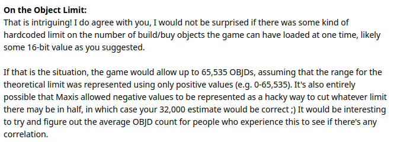

# Object Limit 2: Electric Boogaloo
~~Good~~ Bad news, everyone!

I have returned from a grueling 48-hour adventure deep within the Maxis mines, and have witnessed unspeakable man-made horrors with my own two eyes &mdash; the object limit
is very real and there is nothing that can be done to fix it! The end times are upon us!

Okay, I'm being slightly dramatic. It could be fixed fairly easily, but not with a simple patch, and likely not without access to the source code (anyone else tired of
hearing that excuse?).

The issue is that the limit isn't localised to purely the Build/Buy menu &mdash; it's integral to *every* aspect of the game that involves objects. Here are just a few
examples of the game's functionality that would need modifying to remove the limit:

- Sim pathfinding and routing.
- Mapping tree tables to objects.
- Interacting with objects.
- Manipulating objects within lists (reading/writing/deleting them).

Objects being unselectable in the Build/Buy menu was also a result of this limit and I managed to fix it very quickly, but because The Sims 2 is a house of cards with the
limit as its foundation, everything started falling apart almost instantly.

"So, what is this limit?", I hear you ask. ***32,767***. Yes, you read that correctly. The game is only willing to accept object IDs up to a meager value of 32,767. In
computing terms, this is the maximum value of a signed 16-bit integer. It can store many more objects than this in a list, which is why you can still see all your 4t2 objects
in the catalogue, but it isn't designed to recognise this many IDs and thus can't do anything with them.

### Why are integers signing things? Are they famous or something?
'Signed' refers to the fact that these are integers (an integer is just a whole number btw) that can represent both positive and negative values &mdash; negative numbers have
a negative sign before them, hence the term 'signed'. An unsigned integer is therefore one that can only represent positive values.

While they can both represent the same total of different values, the range of representable positive values differs. Using 16-bit integers as an example:

Unsigned: 0&ndash;65,535
Signed: -32,768&ndash;32,767

This shows that both can represent 65,536 different values, but the range of positive values for signed integers is half of that of unsigned integers. Object IDs cannot be
negative, which means Maxis deliberately chose to use signed integers as a way to cut the ID limit in half.

The cherry on top of all this is that the game is manually converting 32-bit numbers into 16-bit numbers to enforce this limit. This is why I could fix objects not being
selectable in the Build/Buy menu easily, as all I had to do was patch out the conversion. Could EA do this across the whole game themselves if they wanted to? I imagine so.
But then again, if I had billions of dollars, I probably couldn't be arsed either.

### What's an object ID?
An object ID is just a number from 0&ndash;32,767 that the game assigns to each new object it places into a list, presumably starting at 0 and incrementing by 1 for the next
object. It would appear that CC objects are given IDs first, which is why it was solely Maxis objects becoming unselectable after passing the limit.

Sims and objects are stored in separate lists, but I believe they both contribute to the overall limit. My single piece of evidence for this is that I experimented switching
between several hoods and observed that the IDs of objects in the Build/Buy catalogue fluctuated across them. Objects in hoods with subhoods attached had higher IDs than in
those without.

### What was causing the Build/Buy menu crashes?
The same thing I explained in my original post (the game trying to access null pointers), except the creation of these null pointers was no accident and not the result of
something going wrong.

The game merely checks whether the ID for the object it is looking at is above 32,767, and if it is, it deliberately sets the pointer to its address to 0. This would be fine,
if it didn't then try and access this nullified pointer immediately afterwards!

I'll cut Maxis some slack here, because surely no one would be crazy enough to want more than 32,767 objects in their game, right guys? How could they ever have predicted
such a scenario? *(2004 was a simpler time)*.

### Wait, so you were wrong about there not being an object limit? Not so cocky now, are you?
Whoa there, cowboy &mdash; hold your horses. If I may direct your attention to this excerpt of an email I sent to [@teaaddictyt](https://www.tumblr.com/teaaddictyt) on the
22nd of April 2026 at 13:42 BST:

As you can see, I was right all along!!!

In my defence though, we thought the crashing was the only thing we had to solve, which is why I missed the completely obvious 16-bit conversion that was occurring within the
functions I patched. Unfortunately, I am only human, but I understand if you want to destroy all the spockthewok posters I know you have hanging on your walls...

In light of these new findings, if you want to hear my updated opinion on the existence of the object limit, [watch this video](https://www.youtube.com/watch?v=MCT80HJWQ2A).

### Is your patch useless?
Yes, but also no. It's not fixing the object limit (I should probably rename it tbh), but it is fixing those annoying crashes caused by it.

At the moment, not having the Build/Buy menu crash when you try and use it is the best we can do. It's up to you which you find more annoying &mdash; crashing, or not being
able to buy x number of objects in the catalogue. Like the 4GB memory limit, this is going to be an additional constraint we'll have to learn to accept :/

Another alternative would be to join me and the 12 other weirdos who play with no CC, and never have to worry about any of this. No? Oh well, it was worth a try...

### Will you ever actually fix the object limit?
If it's even possible without the source code, then not by myself, no.

Because of the number of core areas of the game that would need patching, I don't trust myself not to miss something and have the game explode. Unless someone wants to
assemble a modding strike force to try and tackle the issue as a team over several months, I'm not touching it with a 10-foot pole (for your safety and for mine).

### Should Maxis go on trial at the Hague for crimes against humanity?
Probably.

Anyway, that's all from me, apologies for the false hope :( One small positive is that I did manage to map out a reasonably large chunk of the game's code while I was
frantically searching for solutions, which should make my life easier when looking at your requests. I feel like I need to successfully complete some of them now to make up
for this dud!

Will

*(Thank god I didn't look at this for my dissertation, I would have failed my degree)*.

---

***Originally Posted:*** *11th May 2026 13:58*

***Tags:*** *sims 2, the sims 2, ts2, object limit, object limit fix, fraud watch*