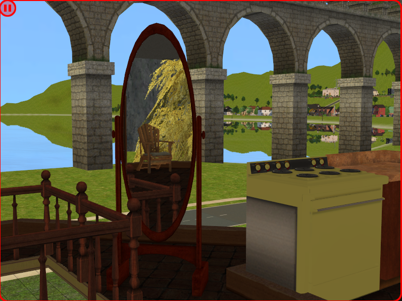
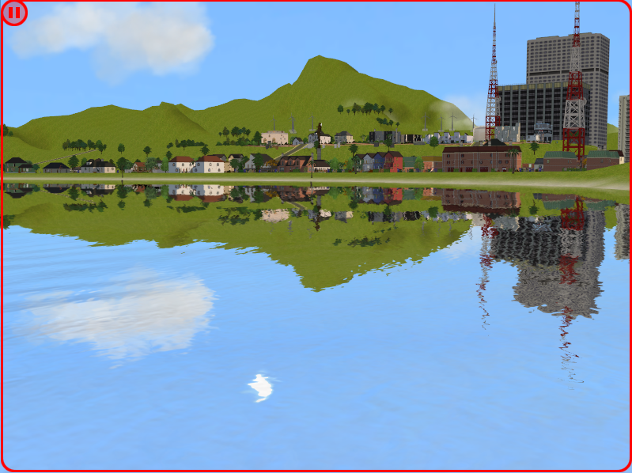
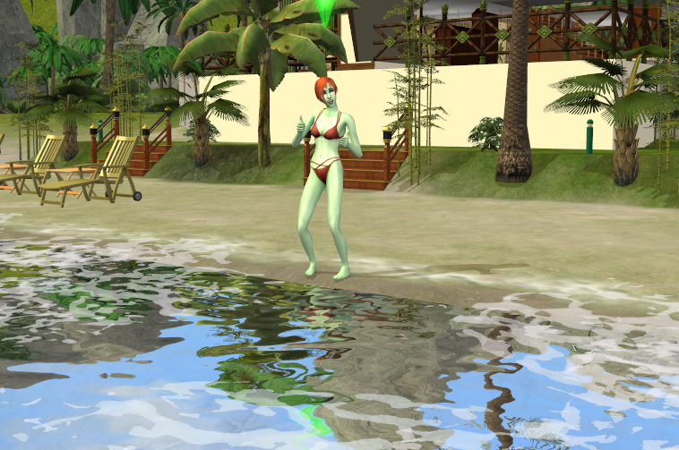
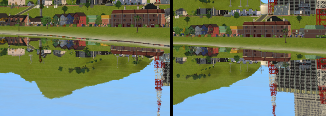
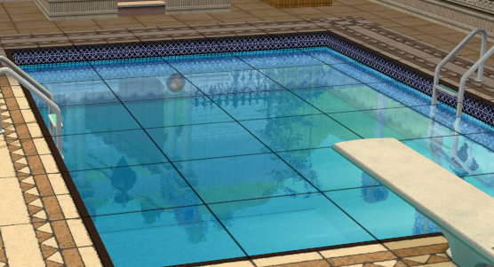
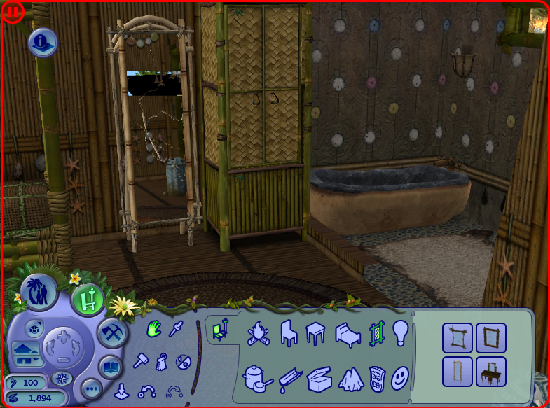
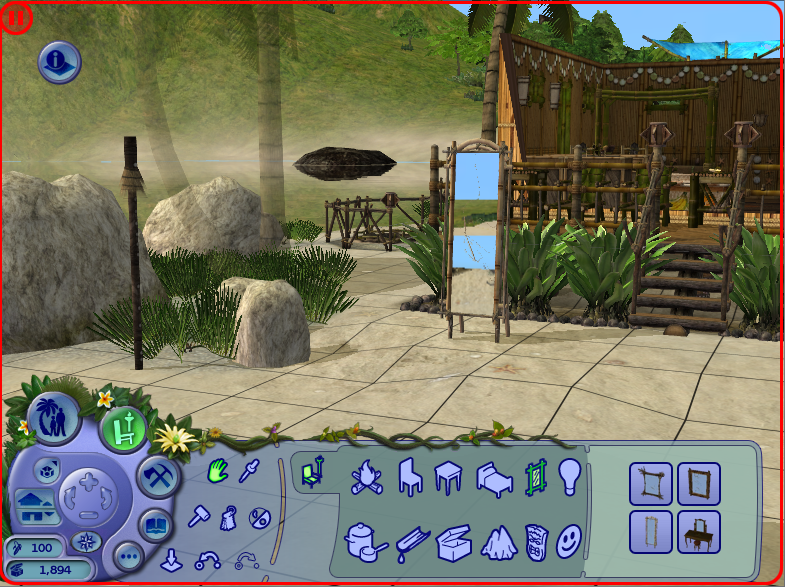
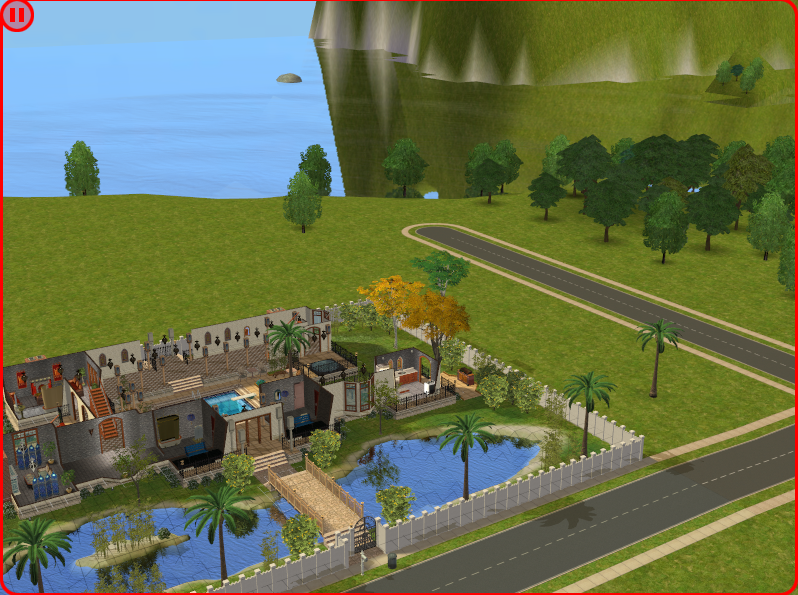
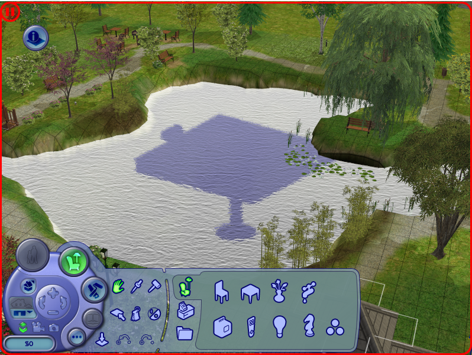
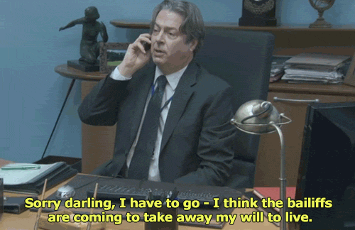

# TS2 Water Mod Update
Hello again!

Sorry for disappearing &mdash; my phone decided to go to silicon heaven a few weeks ago and because I have 2FA set up, I couldn't log in to my accounts until I got a new
phone :/

Anyway, I just wanted to give an update on that water mod I showcased a while back, as it's basically all I've been working on.

This is going to be a long one, so I'm going to make use of that post cut feature for once. I don't mean to be a tease, but there will be a download link provided below :)

Firstly, the good news is that I managed to fix mirror reflections!

<p></p>

I did have to switch back to using the vanilla `OceanReflection` effect to do this, instead of the `ScreenReflection` one used in Castaway (for reasons I'll explain later),
but fear not &mdash; the water is still visually identical and is just as reflective as Castaway.

In fact, I managed to get everything to reflect in the water &mdash; check out those roads and clouds!

<p></p>

And yes, even Sims are visible in the water!



*It's kind of hard to see because of the ripples, but Chloe Curious is indeed present in that reflection.*

Another benefit of using the vanilla `OceanReflection` effect is that Castaway's shaders aren't required for the reflections to work. This means the plugin will work with the
vanilla water shaders, or a different water mod like Voeille's, if you prefer the look of those.

Something else I've tried to do is reduce the visibility of that annoying gap that can be seen between the lot skirt and the ocean's surface. It's not perfect by any means,
but it's certainly an improvement over vanilla imo:

<p></p>

Unrelated to the ocean, but I was made aware of the fact that pools don't reflect the terrain. This has also been fixed:

<p></p>

I'm happy with what I've produced so far, so I've published the mod on my GitHub if you're interested in giving it a try:

[https://github.com/spockthewok/TS2ReflectiveWater](https://github.com/spockthewok/TS2ReflectiveWater)

There are two files available to download. One is the plugin itself, which patches the game to allow for the extra reflections and reduces the lot skirt gap, and the other is
a modified version of Castaway's ocean shaders. I've provided a version of the shaders that incorporate the edits from
[dreadpirate's shader](https://www.tumblr.com/dreadpirate/179182314487/blue-snow-no-more-shader-fixes-ive-included) fixes mod too. Again, these
shaders are **completely optional** &mdash; if you only want the extra reflections, you only need to download the plugin!

## What about pond reflections???
Okay, this is where I have to give the bad news. Pond reflections are not currently included, because they're an absolute nightmare to figure out.

For a body of water to be reflective in TS2, it needs either a reflection plane (which is what the ocean has), or a reflection camera (which is what pools have). Lot terrain
has no such functionality to support this in TS2 (ponds are classed as terrain tiles), so Castaway added a load of extra functionality to make ponds reflective.

It's not feasible to backport all of Castaway's new code to give ponds their own reflection method, and even if it was, it introduces another problem with the game's engine
&mdash; it really does not like two separate reflection contexts using the same render type.

<p></p>

If you ever happen to look at Sims 2's various reflection functions, you'll see several magic numbers being thrown around. These are the game's render types, and the number
that corresponds to each type is defined in the same shader code as the pink soup (I'm never going to be able to escape it). Here are a few examples to feast your eyes on:

```
seti kRenderTypeNormal 0
seti kRenderTypeShadow 1
seti kRenderTypeReflection 2
seti kRenderTypeMirror 3
seti kRenderTypePoolReflection 7
seti kRenderTypeOceanReflection 9
```

Remember the issue with the mirrors? That was related to this. Basically, if the ocean and mirrors are using the same render type for their reflections, the game can't figure
out which reflection belongs to who and the reflections start fighting each other to be displayed.

How did Castaway solve this? It didn't, mirrors are broken in Castaway too, because everything is using render type 2 (`ScreenReflection`).

<p></p>

They *mostly* work if they're placed indoors, but place them outdoors and, oh boy...

<p></p>

Likewise, if you patch the ocean to use the pool reflection render type, the pool reflections start fighting with the ocean reflections for dominance.

So, if we can't create a separate reflection context for ponds because there aren't enough unique render types to use, we're stuck trying to get ponds to use an existing
reflection method.

Let's start with the simplest one &mdash; the ocean's reflection plane. If you recall the issue with ponds from my previous post, that was caused by this same plane. As
discussed, ponds don't have a way to render reflections, so the reflection visible in the pond was actually created by the ocean and therefore being displayed at the ocean's
height, which is why the reflections appeared super far down.

Unfortunately, the game only allows one ocean plane at a time, so if you try to create a second one at the pond's height, it just replaces the ocean's plane. This does give
accurate pond reflections, but at the cost of cutting off the ocean reflections:

<p></p>

I did try and hijack the reflection plane used by the neighbourhood water as it shouldn't technically be in use in lot view, however all this did was give me a one-way ticket
to crash city :(

Evidently, we need a method that supports rendering multiple reflections at varying heights at once, which leaves us with two options (to my knowledge):

1. The reflection camera for pools.
2. The reflection camera for reflective floors.

I don't think floor reflections are a thing in Sims 2, despite there being code for a reflection camera in the game's binary, so who knows if it even works. The floor shader
code contains this quote:

> `reflective floors are currently dead. might ressurect them in an expansion pack`

Great, now we're down to pools as our last hope.

As you probably know, if ponds use `PoolReflection`, they appear black without a pool present on the lot. Maybe if we lift this restriction, things will start working? Think
again:



*I have no idea why there is a chess table(?) baked in to the reflection texture.*

I guess that makes sense &mdash; the game also isn't creating the pool reflection camera, as it only does so if a pool exists. What if we allow the camera to be created
regardless of the presence of a pool?

While doing this allows ponds to now 'reflect', the reflections are still broken, being displayed at the wrong height and sliding around with the movement of the camera. It
expects to be given several bits of information to work properly, such as a node for it to be attached to, the bounds of the pool, and the depth of the water &mdash; all
things ponds are not giving it.

Compounding this is the fact that ponds have very little functionality to work with to provide this information. You can get the elevation of the water (which I suppose could
be used as the depth), but other than that, all there really is is a way to check if a specific terrain tile is a pond tile.

This creates all sorts of headaches, like how to differentiate between multiple ponds on a lot, getting the width and height of them, what the camera should be attached to,
yada yada yada...

It was at this point that I started to wonder &mdash; is this really even worth it? Sure, placing a pool tile on a lot to get pond reflections working is a bit janky, but
would whatever Frankenstein's monster of a pond reflection system I might be able to create be any less janky?

For this reason, I have decided to take a short break from pond reflections, as I was starting to get a metaphorical concussion from banging my head against the keyboard to
try and figure something out. I know it's disappointing to hear, but hopefully the fancy new ocean reflections will soften the blow somewhat.

If anyone has any suggestions for pond reflections, I'm more than happy to hear them :) I'll return to the trenches soon...

<p></p>

Will

---

***Originally Posted:*** *8th June 2026 19:22*

***Tags:*** *sims 2, the sims 2, ts2, sims 2 download*