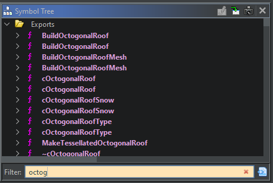
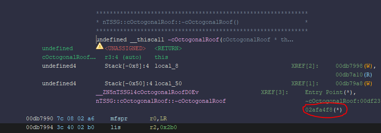
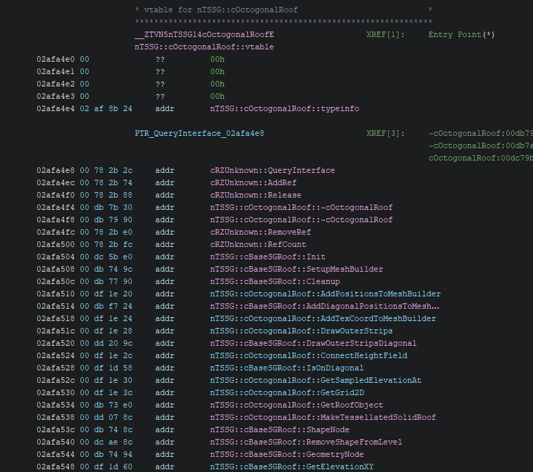
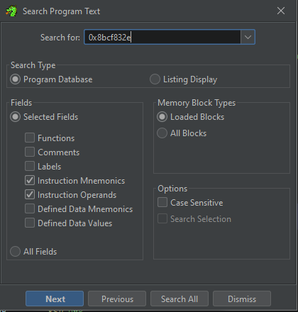
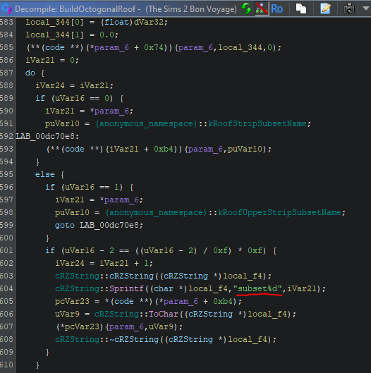
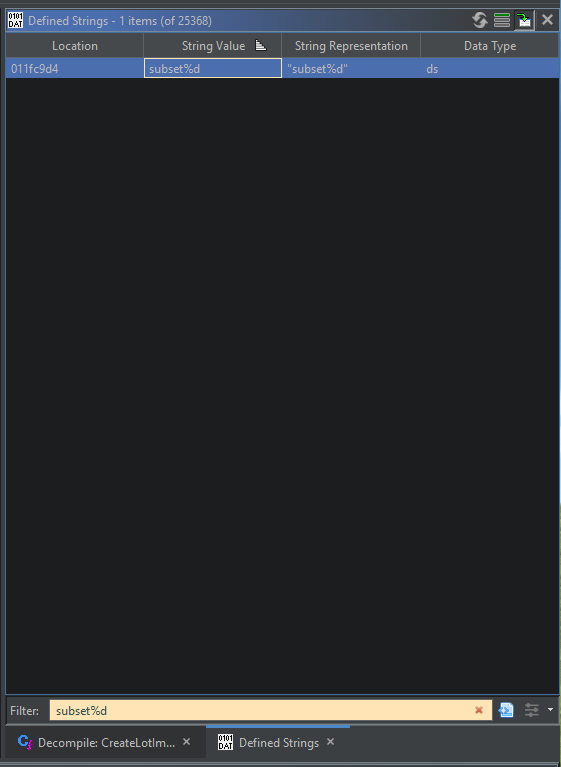
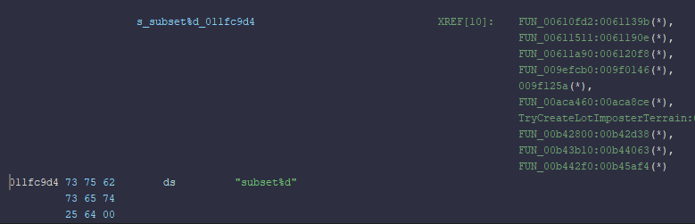

> Hi, I had a technical question for you because you've decompiled the Sims exe. I'm hoping to fix a glitch in TS2 where octagonal roofs leave rooms below them filled with
> roofing. They should behave like the rectangular roofs and create emptied rooms beneath them. I'm not a programmer, but my brother is and I've asked him to help me with
> this glitch. We're using LD's Mac version with debug symbols and I've asked him to help me decompile it so we can fix the glitch. Since you're familiar with TS2 code, I
> wondered if you could point us in the right direction when it comes to roofs? I'm sorry if that's vague and I know you're definitely busy! Alternatively, any advice would
> be welcome.

> [wisbridgesims](https://wisbridgesims.tumblr.com)

Hi! I'm always happy to share my limited reverse engineering knowledge :)

If you're using Ghidra, there's a section to the left called 'Symbol Tree'. Each type of roof has its own class, so I'd start by searching in the macOS binary for
methods/classes containing the substring "octogonal" (yes, it's spelt wrong internally :/).

If you select one of the classes starting with a tilde (~), you can double click on the hex XREF (`0x02afa4f8` in this example) to go to the class' vtable, which contains the
methods used by that class:

I'd then go through the methods in the vtable that seem of interest, and make a note of any that might be responsible for the problem you're trying to solve. If nothing
stands out, then it's back to the symbol tree to sift through the other results.

I don't know how deep you're planning to go, but if you're looking to debug the game to see what the code is doing at runtime, then the real bastard is cross-referencing the
macOS binary to the Windows binary to be able to get an address to set a breakpoint on.

If the method you want to find contains a string, your life is much easier because you can search through all the defined strings in the Windows binary and follow the XREFs
to that string back to the method you're trying to locate.

If it doesn't contain a string, I'd look for other methods in the vtable that do, or for ones that contain semi-unique hex numbers. Hex numbers are useful because you can
search through all the instructions that use them in Ghidra by pressing CTRL+F:

Thankfully, here we can see that `BuildOctogonalRoof()` contains the string `"subset%d"`:

We can now search for this in the Windows binary and check the XREFs to it to determine which is the Windows equivalent of `BuildOctogonalRoof()`:

Determining which of those XREFs is the method you're looking for is a case of analysing the structure of each, and seeing which best matches the macOS version. It's rare
that they'll be identical across both platforms, so if you're really unsure, you can copy the address of the first instruction in a method, jump to it in your debugger, and
set a breakpoint on it. If the breakpoint is hit when you try and build an octagonal roof, you'll know you've likely found the right one!

*I'll give you a free hint &mdash; the last XREF in that screenshot (`FUN_00b442f0`) is the Windows version of `BuildOctogonalRoof()` ;)*

Once you've found it, you can work back through the XREFs to `BuildOctogonalRoof()` to end up in the `cOctogonalRoof` class vtable.

To save yourself having to try and relocate the method this way again later, you can right click on its name, select "Rename Function", and rename `FUN_00b442f0` to
`BuildOctogonalRoof` &mdash; you can see I've already done this for `TryCreateLotImposterTerrain()`. This will allow you to simply search for "BuildOctogonalRoof" in the
symbol tree of the Windows binary the next time you want to find it.

I hope this helps! I was probably a bit vague and used a bit too much jargon, but this post would end up being a 10,000 word essay otherwise...

Good luck! *(And let me know if you need any more help).*

---

***Originally Posted:*** *7th July 2026 21:29*

***Tags:*** *sims 2, the sims 2, ts2, ask, reverse engineering*