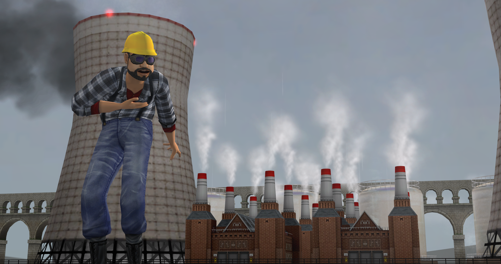
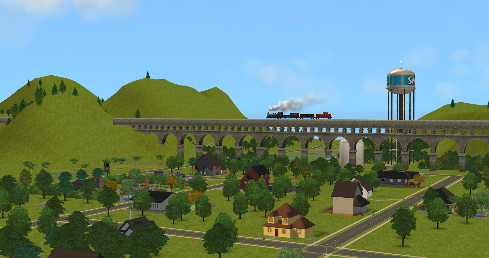
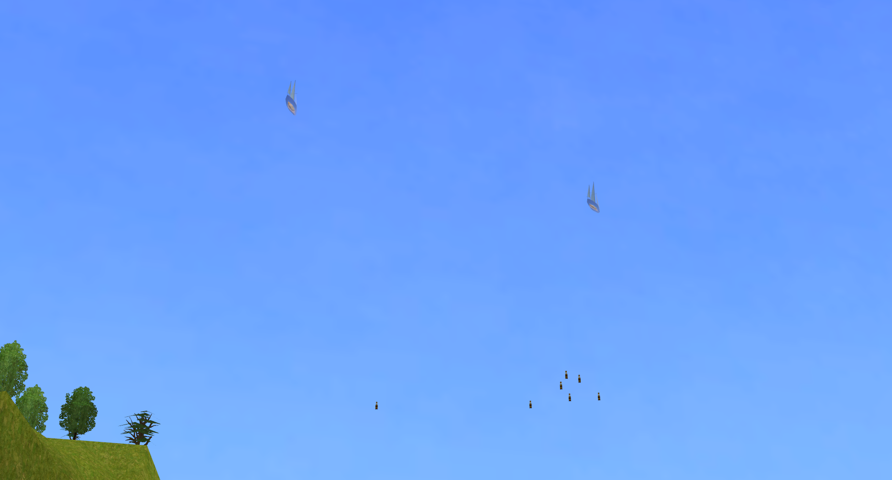
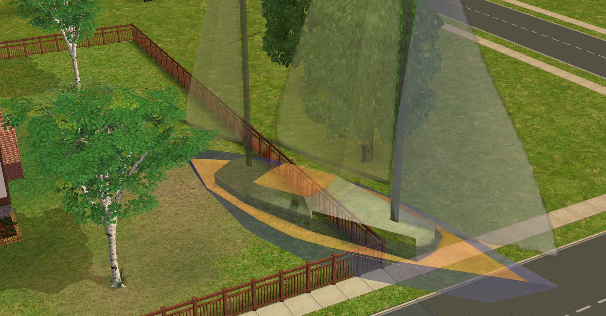
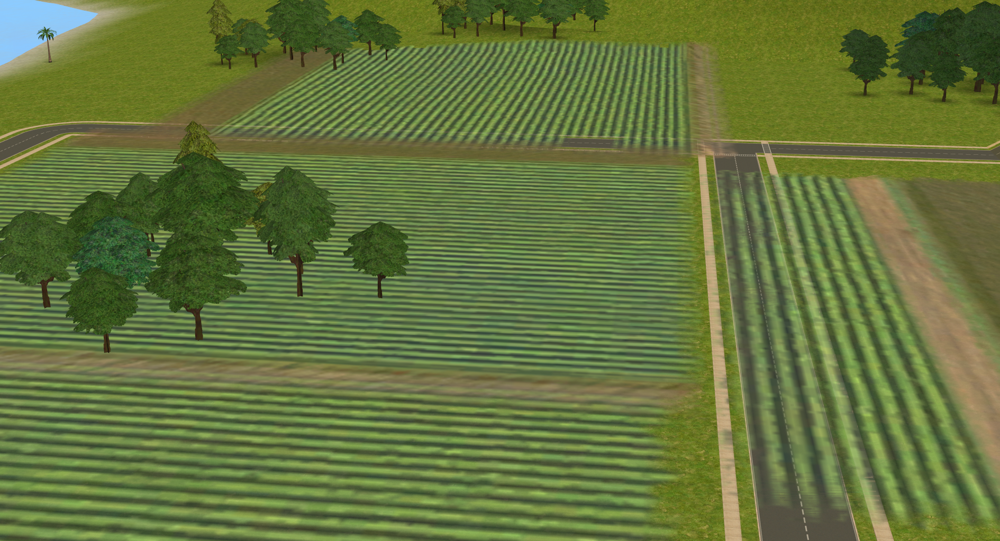
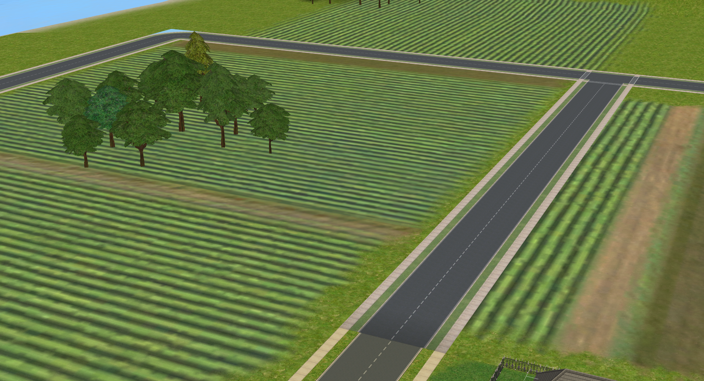
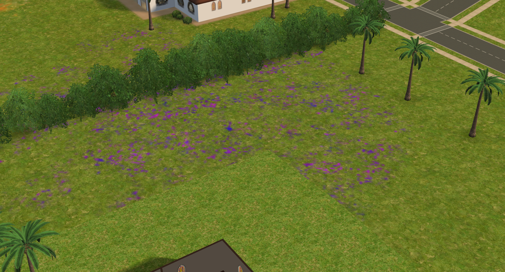

# TS2 Visible Hood FX
Ever wondered why all the power plants you decorate your neighbourhoods with suddenly shut down whenever you enter a lot? Do the workers organise a mass strike during each
loading screen? And who's the joker who keeps stealing all my farm fields???

With TS2VisibleHoodFX™, you can bust those pesky power plant unions and have your Sims marvel at the wonders of the industrial revolution from the comfort of their homes, as
toxic pollutants pour into the atmosphere day and night! Mmm... Fossil fuels...

*Complete global saturation.*

*Desiderata Valley &mdash; note the wild flowers, farm fields, train, and blinking water tower light.*

Because neighbourhood effects were never designed to be seen in lot view, there are a few minor issues you should be aware of. I'll have to get into some technical details,
so I'm leaving all the nerd stuff below the cut.

As always, you'll need either the Ultimate Collection or the disc version with all EPs and SPs to use this mod.

**[DOWNLOAD](https://github.com/spockthewok/TS2VisibleHoodFX/releases/latest)**

**[README](https://github.com/spockthewok/TS2VisibleHoodFX/blob/main/README.md)**

## Issues
Maxis gimped the lot skirt's functionality when compared to the neighbourhood terrain and lot terrain. The most obvious example of this is the lot skirt looking like absolute
ass, while the neighbourhood terrain has detailed cliffs etc. &mdash; both the neighbourhood terrain and lot terrain support multiple paint layers and alpha maps, whereas the
lot skirt is just one, boring texture.

Unfortunately, these limitations cause some semi-annoying problems when forcing hood effects to show up in lot view.

### Certain effects have bugged positioning
When you download the mod, you'll notice that along with the usual plugin, there's a config file included too. This config file is important, as it allows you to blacklist
neighbourhood effects to prevent them showing up in lot view.

Why might you want to blacklist effects? Well, several effects appear to require something called an 'effect map' to be positioned correctly in the world (don't ask, I don't
know what an effect map is either).

The neighbourhood terrain and lot terrain both have an effect map, but importantly, the lot skirt does not. This means that the effects that rely on an effect map for their
positioning (mainly those that are placed on water) will appear way up in the sky when you load in to a lot:

If you want to know why they get placed in the sky, it's related to a peculiar bug(?) I discovered while trying to figure out why decal effects (e.g. farm fields and wild
flowers) weren't appearing in lot view, even though I could clearly see the game creating and processing them in the debugger.

Basically, things like decals and shadows need to be assigned to an overlay manager which… manages overlays. For whatever reason, when you load a lot from the neighbourhood,
rather than assigning these to the lot terrain or lot skirt overlay managers like the game logically should, it instead assigns them to the neighbourhood terrain overlay
manager. The same thing happens with the effect maps &mdash; the neighbourhood effect map is used, not the lot terrain one.

The neighbourhood terrain coordinates aren't actually 1:1 with the lot skirt. The game generates the lot skirt below the neighbourhood terrain during the loading screen, and
translates the position of each object downwards. Couple this with the neighbourhood effect map being used, and you get boats sailing around in the sky.

It isn't until you travel to a community lot or switch to another playable household while in lot view that the game starts using the relevant lot effect map and overlay
managers. For example, if you load the Goth household from the Pleasantview neighbourhood screen, then click on the Pleasant's house to switch to them, boats will suddenly
start sailing around in their garden as the lot terrain effect map is now in use:

I have no idea whether this quirk has any noticeable effect on gameplay, outside of when trying to get neighbourhood effects to appear in lot view. I've already patched the
decals so they correctly get assigned to the lot skirt overlay manager when loading from the neighbourhood, but I'd be interested to know if there are any instances of lot
effects not appearing until switching lots due to the incorrect effect map usage!

The config file is preconfigured to blacklist any problematic vanilla effects, so you don't need to worry about adding these yourself &mdash; it's mainly there in case you
run into any custom hood effects with bugged positioning that you'd want to prevent appearing in lot view.

### Decals appear on top of roads
Decal effects will draw over roads in lot view, instead of drawing underneath them like in hood view, as they should do. I can't say for certain why this happens, but I'm
pretty sure it's due to differences between the neighbourhood road materials and the lot skirt ones.

If we patch the code that creates the lot skirt roads to simply use the name of the neighbourhood roads instead, we can see that although the roads no longer match the
surrounding terrain and have huge holes in them, the decals do correctly draw below them. Weird, right?

Either way, you should probably move any farm fields and wild flowers away from the roads to avoid this happening.

### Decals that overlap the current lot's bounds get cut off
This is due to the lot skirt and lot terrain being two separate entities, each with their own overlay managers. Decals can only be assigned to one of these managers, so are
unable to be drawn by both.

The lot skirt also does some maths to mask out the lot bounds, which prevents it from drawing its overlays over the lot terrain. You can patch out this mask and allow decals
to overlap the lot, but it causes all of the decals and shadows on the lot to flicker like crazy, as both the lot skirt and lot terrain are fighting to draw their overlays on
top of the other (aka z-fighting).

---

***Originally Posted:*** *5th August 2026 15:04*

***Tags:*** *sims 2, the sims 2, ts2, sims 2 download, visible hood fx*