# Exploding Imposter Research
Picture this scene... You've got home from long day at work and decide to boot up your favourite game (The Sims 2™) as a means to unwind before you inevitably have to take
care of your own sleep motive and go to bed. Wanting to escape the stresses of your own reality, you figure building and decorating a lot would be more relaxing than
micromanaging the needs of virtual people who won't stop screaming at you about the puddles of pee and dirty plates they themselves left everywhere.

After spending a couple of hours fighting with the game's awkward object rotation system, you finally feel satisfied enough with what you've done to save and exit back to
neighbourhood. You hold your breath and close your eyes as you do so, praying to every higher power you can think of that the game doesn't crash for the 10,000th time during
the loading screen.

As the sound of *Sims 2 Theme (Timo Maas Remix)* fills your ears, you let out a sigh of relief &mdash; you made it. You slowly open your eyes and...

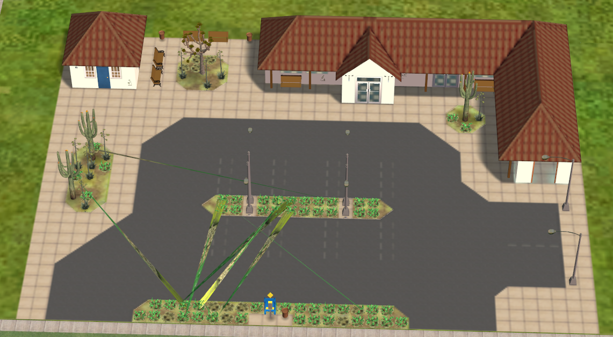

Too tired and confused to get annoyed, you crawl into bed and softly cry yourself to sleep. Another day as a cog in the corporate machine awaits you in the morning...

Has this ever happened to you? If you answered yes, you may be eligible for compensation. Please contact Electronic Arts for more information.

Joking aside, many moons ago [@teaaddictyt](https://www.tumblr.com/teaaddictyt) asked me to look into this strange phenomenon of ‘exploding' imposters. It's taken me a while,
but I think I've seen enough of the game's code to propose a strong theory as to why it happens. If you wish to join me on this adventure, please meet me below the cut :)

*Content Warning: Maths, jargon, vague explanations, and a hell of a lot of text.*

Before we begin, I'd like to preface that although I'm an amateur programmer with a degree in Computer Science, there are two computing related topics that elicit a visceral
reaction in my brain similar to a migraine whenever I have the misfortune of encountering them:

1. 3D modelling.
2. SimPE *(I'm counting this as computing adjacent because it requires a computer to use &mdash; sue me).*

This means I'll probably be throwing around various terms without really explaining them, because I myself don't properly understand them.

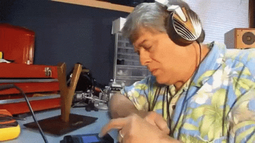

*Actual footage of me trying to understand Blender.*

I'm also going to be using several pieces of custom content to help demonstrate this issue. If you're the creator of one of the mods I'm showcasing, please don't see this as
me criticising your work. It's much easier to find custom objects that explode than Maxis ones, so they're being used purely for the sake of convenience and to better
illustrate what's going wrong behind-the-scenes.

With that out of the way, let's cut to the chase.

## The Boring Technical Section
### GMDCs
Why do certain meshes (particularly imposters) have a tendency to explode in TS2? Well, I believe it's entirely caused by the number of vertices an object's mesh has.

You see, the game stores meshes using something called a Geometry Data Container (GMDC). Below we have an excerpt of the information stored in the GMDC for those cactus
flowers (Nopalito's Prickly Pears) you can buy from the build mode catalogue:

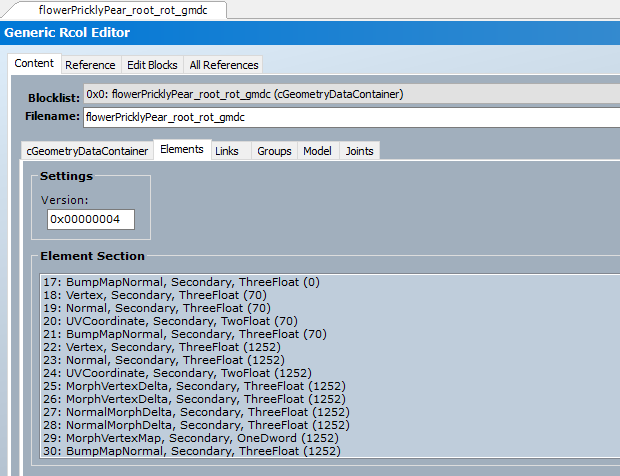

The only piece of data we care about here is the number of ThreeFloat vertex elements in the GMDC, which for the main cactus model, appears to be 1,252 (make a note of this,
we'll be coming back to it later).

Now, when the game is creating a lot imposter, it takes all of the identical objects on the lot, finds their associated LOD model, and repackages their data into one large
GMDC, creating a single LOD mesh (presumably because it's less demanding than rendering each mesh individually).

It is important to note that the objects have to be completely identical to be merged into the same GMDC. If you have two of the same car object on a lot, but you've used the
design tool on one of them to change its colour, these would be considered two different objects and would be packed into separate GMDCs.

As part of this process, the game takes each piece of information for the meshes it is merging and places them into a data structure, with each entry in the data structure
being given a unique index.

For example, the first vertex of the first cactus mesh being merged will be put into the data structure used for storing vertices, and assigned to index 0. Then, the
coordinates for this vertex will be placed into the data structure for coordinates at index 0 too, and so on. This way, you know that everything stored at index 0 across the
separate data structures is related to the same part of the mesh.

However, this indexing system is where the flaw lies...

### Revenge of the Bits
If you can recall the great object limit fiasco of 2026, you might remember that Maxis decided to put a 16-bit limit on the number of OBJDs the game can process.
Unfortunately for us, they decided to do the same thing for the number of indices that can be assigned to the entries of the data structures belonging to a GMDC, providing us
with a grand total of 65,536 possible indices (0&ndash;65,535), regardless of the fact that more than 65,536 pieces of data can be stored in these structures.

I'm going to have to represent numbers using hexadecimal for this next part, so if you're not familiar with this numeral system, all you need to know is that a hex number is
16-bit if it's 4 digits long (e.g. `0x0000`&ndash;`0xFFFF`), and 32-bit if it's 8 digits long (e.g. `0x00000000`&ndash;`0xFFFFFFFF`). You can convert hexadecimal numbers to
decimal using a site such as [this one](https://www.rapidtables.com/convert/number/hex-to-decimal.html).

Anyway, the indexing system works like this:

1. The game receives a 32-bit index, such as `0x0000ABCD`.
2. This is manually converted to 16-bit by essentially discarding the first 4 digits.
3. The final result is therefore `0xABCD` (43,981 in decimal).

This works fine when the game is storing the first 65,536 vertices for the combined mesh, as the first 4 digits of the original 32-bit index will all be zero, so can be
cleanly trimmed off. But what happens when we get to 32-bit numbers like `0x00010000`? Well, we discard the first 4 digits as always and...

Oh... We're back at index 0x0000, which is already being used by the first thing we processed when we started merging the meshes. Now we have two different vertices, both
using the same data for things like positioning, as this is also stored in a separate structure at index 0.

The result? You have an object mesh with vertices using positional data from other object meshes, causing them to draw from wherever these are located on-screen. If the
object only has a few vertices that are affected, then you have a mostly normal looking model, but with certain sections stretching off to to the wrong places, giving that
'exploding' look. If ALL of the vertices are affected, then the model appears to vanish into thin air, as I assume its vertices have the exact same positioning as another
model, so they end up drawing on top of each other.

Why would Maxis choose do this? Because it's 2004, man! I've got a single-core Pentium 4 CPU, 512MB of RAM, and a NVIDIA GeForce 6600 GPU with a whopping 256MB of video
memory. Being able to comfortably render multiple meshes with more than 65,536 vertices is crazy sci-fi stuff, and by the time that's possible, I'll be playing whatever the
newest Sims game is! Do you really think I'll still be playing The Sims 2 in 22 years???

## The Evidence
### Exhibit A
Let's return to those prickly pears. Normally, flowers won't get added to an imposter, so we're going to use
[this cool mod](https://www.tumblr.com/tflc/182195354530/garden-flowers-visible-in-neighbourhood-default) which gives them a LOD mesh using the mesh they'd have in lot view.
We're also going to take a taxi back to the community lot we've been seeing in these screenshots (5 Pentameter Parkway, Veronaville), as Maxis very kindly placed 63 of these
cacti here for us.

While we're waiting for the loading screen to finish, we'll crunch some numbers for the test we're about to conduct.

We know from earlier that the cactus mesh has 1,252 vertices (unless you forgot to make a note of it, like I said you should).

63 cacti x 1,252 vertices = 78,876 vertices for the combined mesh, which is way over the index limit of 65,536 we have to work with &mdash; in fact, it's 13,340 vertices over the limit.

13,340 / 1,252 = ~10.65 objects where all vertices will have an index above the limit. If you go back to one of the screenshots of this lot and count how many dirt piles
there are with no cactus sat on top, you'll find there are exactly 10 of them.

Still not convinced? Okay, let's calculate how many cacti we can place to land just below the limit, and how many will push us over the limit:

52 x 1,252 = 65,104 (below the limit)

53 x 1,252 = 66,356 (above the limit)

If this theory is correct, then having 52 cacti on the lot should not result in an exploding mesh, whereas having 53 should.

Here is the imposter with 52 cacti:

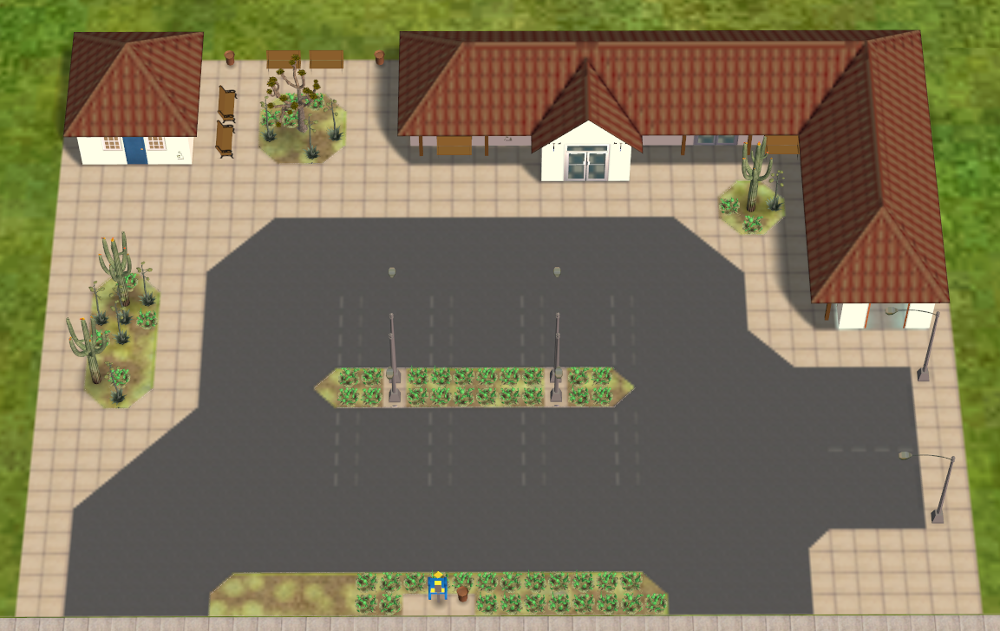

And here is the imposter with 53 cacti:

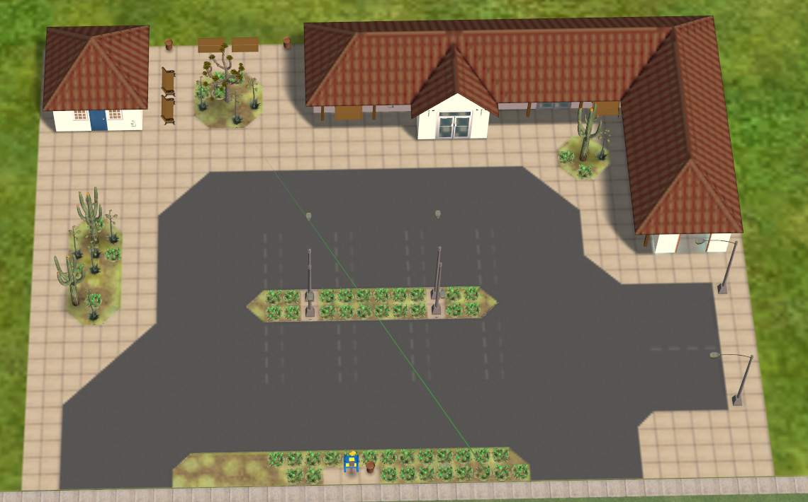

Well, what do you know?

### Exhibit B
Next, we'll look at a Bentley model that was giving [@gummilutt](https://www.tumblr.com/gummilutt) a bit of trouble, and that also uses its live mode model for its LOD model.
This bad boy has 25,425 vertices, which should make our second test nice and quick.

25,425 x 2 = 50,850

25,425 x 3 = 76,275

We should therefore be able to safely place two of these cars in a lot, with a third car causing an imposter explosion.

2 cars:

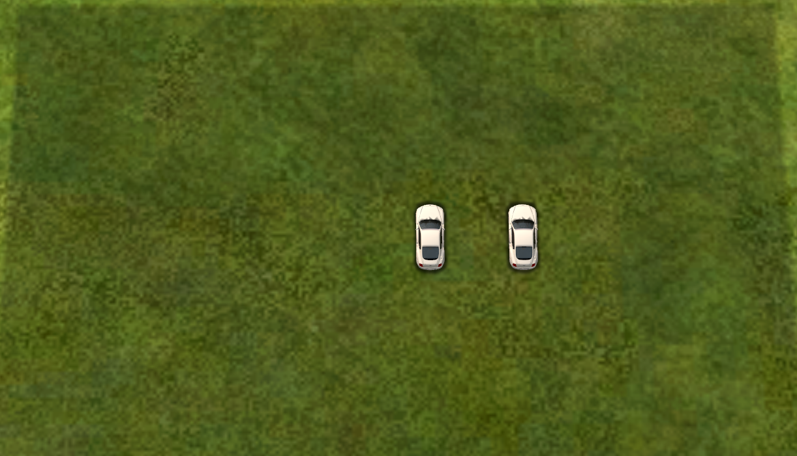

3 cars:

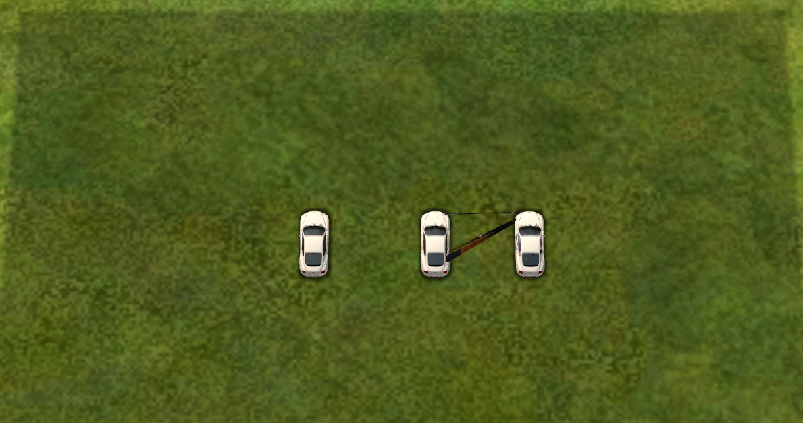

Are you starting to believe yet?

### Exhibit C
Finally, we have this poor lot that TeaAddict made, which makes heavy use of the mid-size hedges from
[here](https://www.tumblr.com/lottes-little-place/682149769427255296/after-seeing-tvickiesimss-post-with).

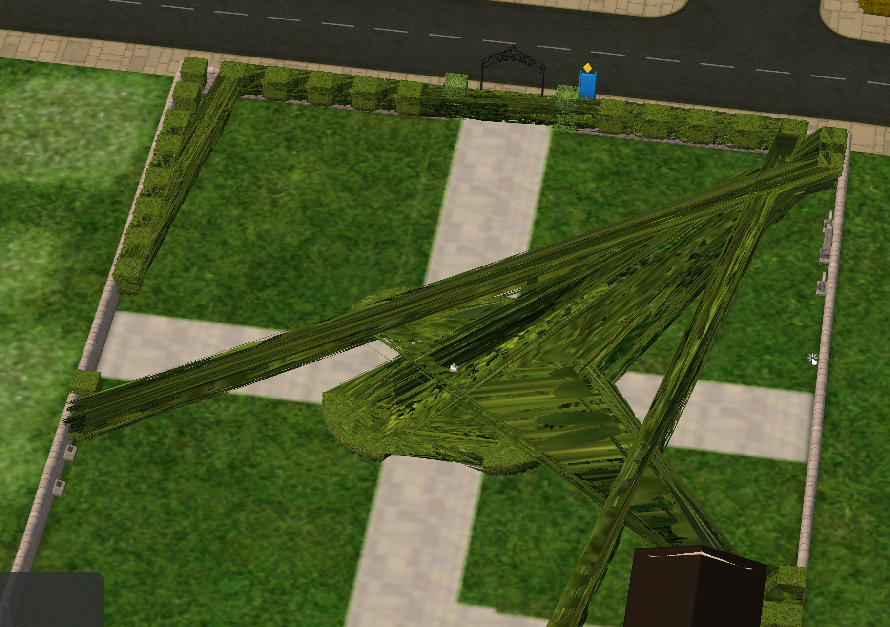

You know the drill by now &mdash; the hedges have 2,295 vertices, so let's do our usual calculations.

2,295 x 28 = 64,260

2,295 x 29 = 66,555

28 hedges:

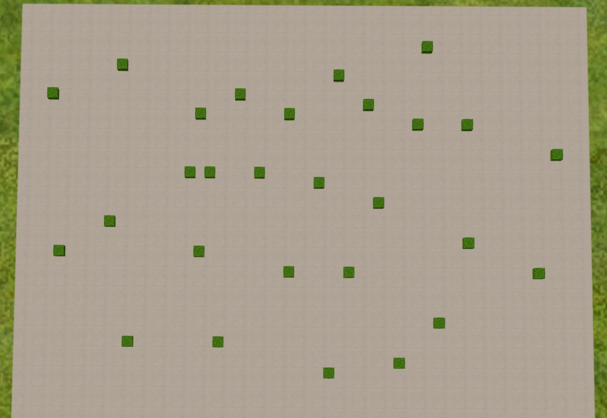

*I deliberately placed these sporadically to make the inevitable explosion more obvious.*

29 hedges:

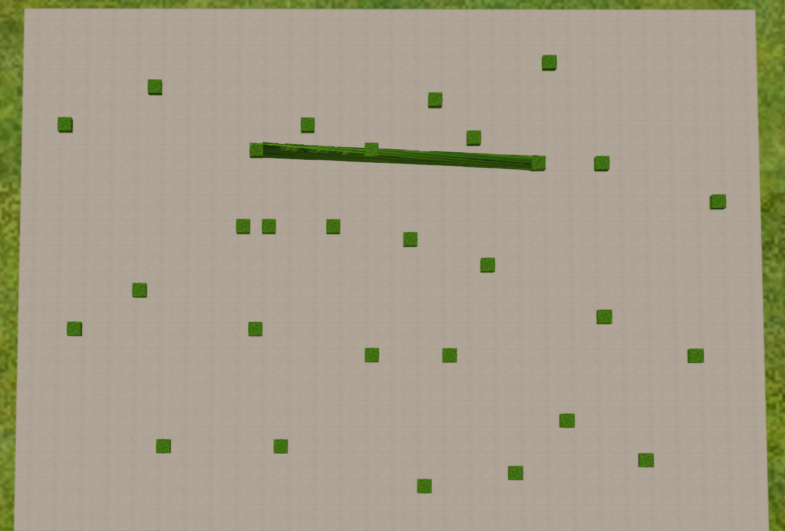

Yeah, yeah, we get it. It's not exactly surprising anymore. BUT, what if we imported this mesh into Blender and reduced its number of vertices? Luckily for us, TeaAddict did
just that:

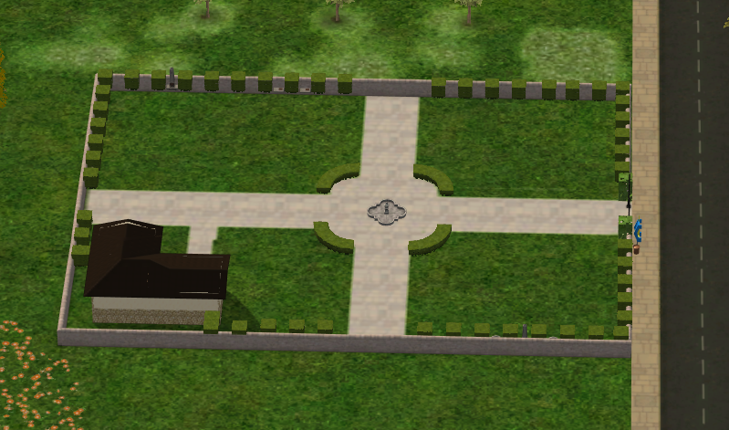

And with that, your honour &mdash; I rest my case.

## The Conclusion
If you've made it this far, congratulations &mdash; you survived. I can't say I expected this post to be this long, so hopefully you at least understood some of what I was
trying to demonstrate.

The bad news is, just like the object limit, this 16-bit constraint is deeply rooted into a number of subsystems within the game's code, making it very difficult to remove
through patching without inadvertently breaking something.

Even worse, it's not just lot imposters that can explode either. Take a look at these exploding neighbourhood trees I caused in Castaway Stories:

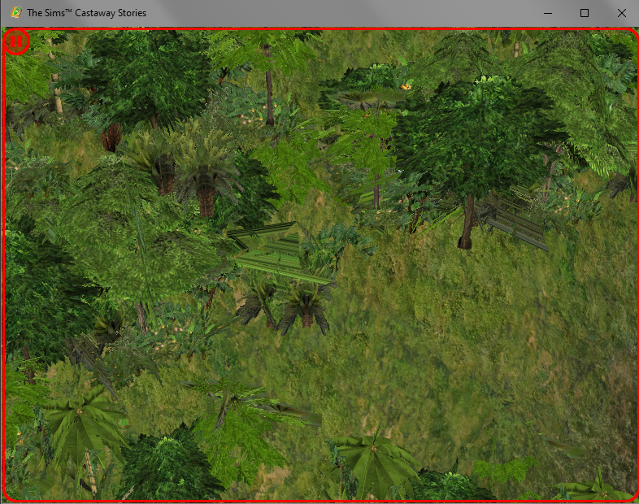

And how about these trees that Gummilutt had explode?

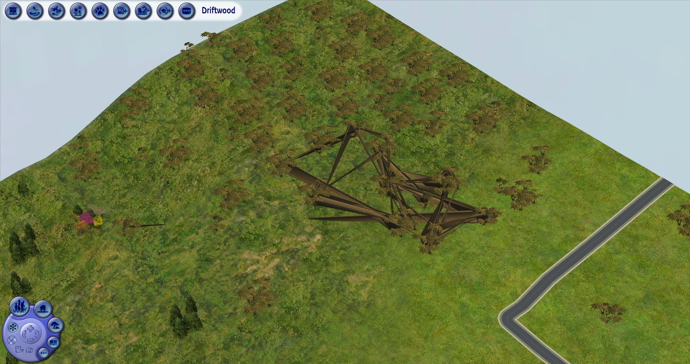

So, what can we do?

If you're a mod author creating neighbourhood deco or objects that will appear in lot imposters, try to make a separate LOD90 model with as few vertices as possible. If
you're a mod user, then... I don't really know what to suggest other than removing some objects from a lot once you notice they start exploding.

Apologies for dropping a second limit-based nuke on The Sims 2 community within the same year. As long as no one gives me another request that sends me down one of these
rabbit holes, this should be the final one *(famous last words?)*.

Anyway, I'm calling it a night. Enjoy this horrifying new knowledge!

Will

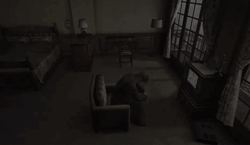

---

***Originally Posted:*** *23rd August 2026 21:24*

***Tags:*** *sims 2, the sims 2, ts2, exploding imposters, research, long post, psychological horror*