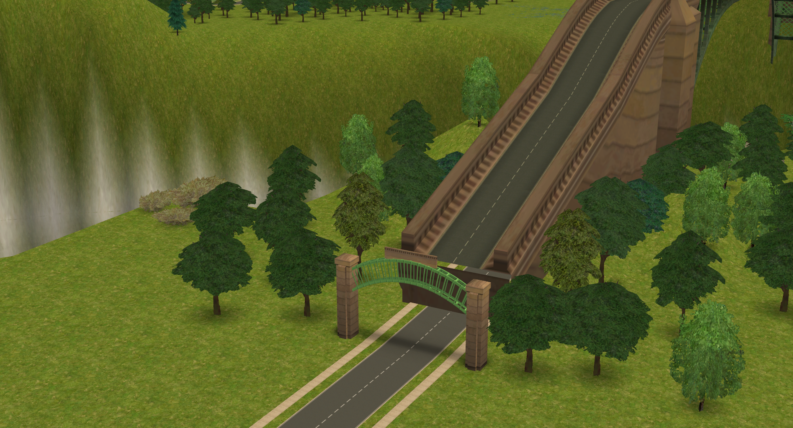

# TS2 Visible Hood FX v1.2.0
*Now with 100% more bridges!*

Having those neighbourhood bridges appear in lot view was something I always wanted to include in the visible hood fx mod, but I didn't know how feasible it would be due to
them not being set up to have their positioning translated to the lot skirt's coordinates.

Thankfully, all it took was a crash course on Euler angles and quaternions, and now they're here!

Do you hear that? That's the sound of everyone in Pleasantview letting out a collective sigh of relief, as their car insurance rates have just dropped dramatically.

**Very Dangerous Vanilla:**

**Much Safer Mod:**

And it's not only the residents of Pleasantview who are raving about this latest update! Just listen to these reviews from the mod's users:

*"I'd never noticed that Maxis forgot to connect the roads to the bridge in Riverblossom Hills, but thanks to TS2VisibleHoodFX v1.2.0, it's now impossible for me NOT to
notice!"* &mdash; Mr. W. Nixon, 26, UK.

If that's not enough, I've even thrown in an update for TS2ReflectiveWater which allows these marvels of engineering to be reflected in lot view water. Wow!

***TS2VisibleHoodFX:***

[**DOWNLOAD**](https://github.com/spockthewok/TS2VisibleHoodFX/releases/latest)

[**README**](https://github.com/spockthewok/TS2VisibleHoodFX/blob/main/README.md)

***TS2ReflectiveWater:***

[**DOWNLOAD**](https://github.com/spockthewok/TS2ReflectiveWater/releases/latest)

[**README**](https://github.com/spockthewok/TS2ReflectiveWater/blob/main/README.md)

*You need the Ultimate Collection or disc version with all EPs and SPs to use these mods.*

---

***Originally Posted:*** *27th August 2026 19:48*

***Tags:*** *sims 2, the sims 2, ts2, visible hood fx, update*