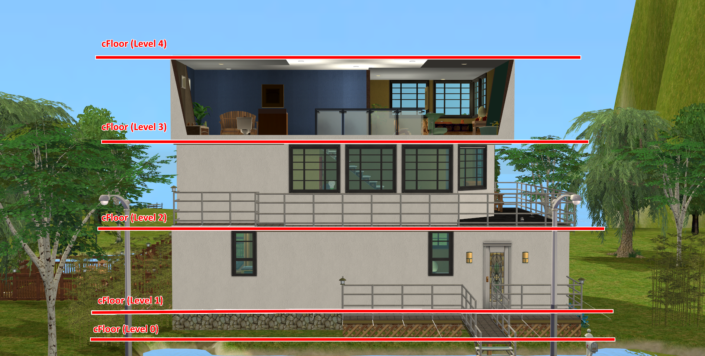
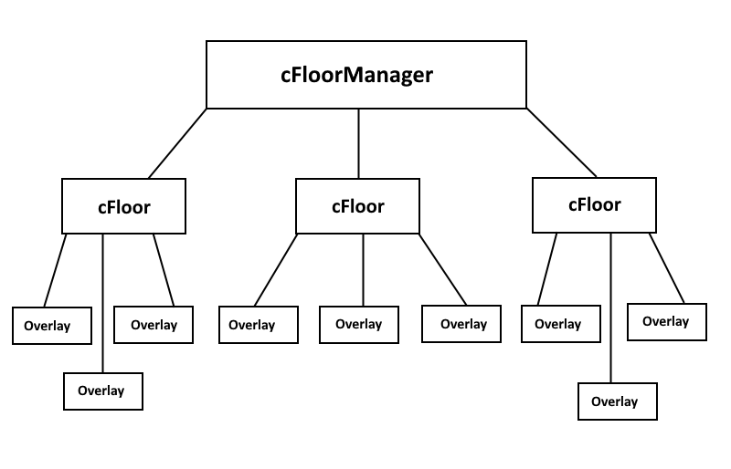
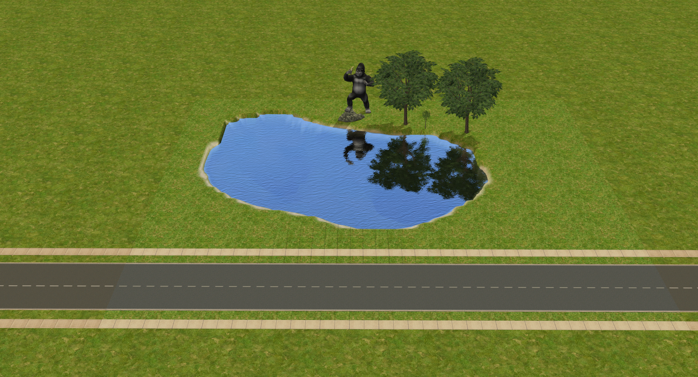
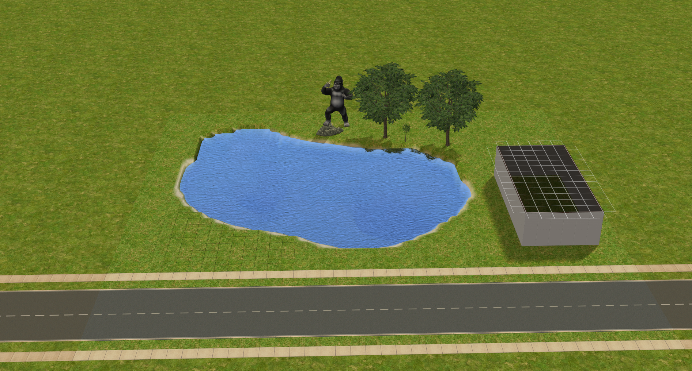
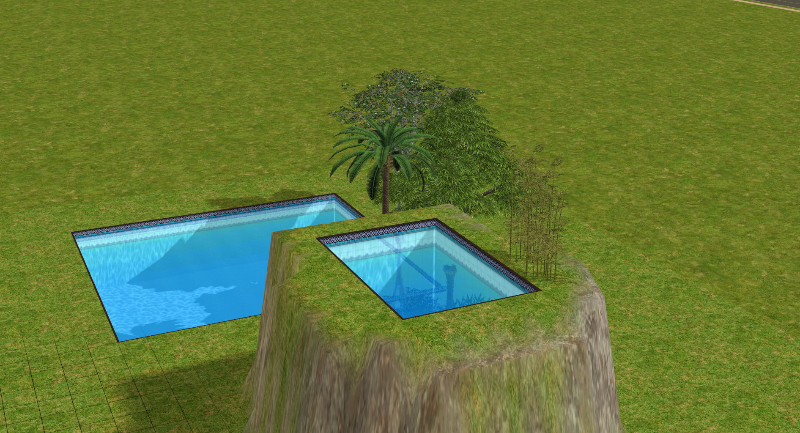
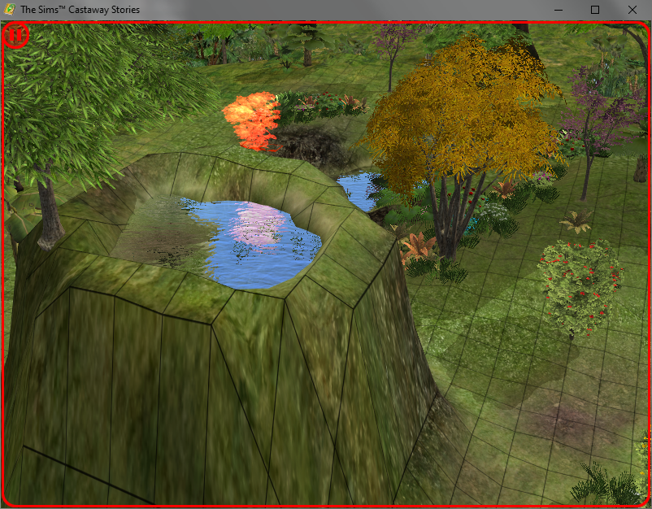

# TS2 Pond Reflection Experiments
Recently I decided to completely rework my Beta Floors mod to make it, well... less shit.

You see, how it worked originally is that each time you selected a floor tile from the Build catalogue and went to place it, the mod would grab the material name of the
floor, check it against every entry in a big list containing all of the material names of reflective floors, and attach the floor reflection camera if the selected floor was
found in said list.

The problem with this was that this was happening each time the tile was moved around the placement grid, meaning that the list was essentially constantly being checked, and
the reflection camera constantly being attached.

This is incredibly stupid and inefficient, so I took the time to better understand the game's floors and reflections, which in turn, somehow led me down a rabbit hole of
revisiting the dreaded pond reflections I said I'd work on many eons ago...

Like the rest of my posts, this one can be described as being equivalent to verbal diarrhoea, and I'm also going to be assuming you've read my previous posts about floor and
pond reflections. You have been warned.

Before we get to the ponds, I'm going to have to briefly and poorly explain how floors work, because I just can't help myself.

First we have the global floor manager (`cFloorManager`), which is responsible for creating an individual floor object (`cFloor`) for each level of the lot. *I'm going to use
the term 'level' instead of 'floor', as that's what they're called internally and it'd get confusing using the same word to describe both the floors themselves, and which
'floor' of the house they're tied to (e.g. ground floor, first floor etc.).*

To better illustrate this, I've created a nifty diagram to show the floor objects the manager has created for this lot, with the terrain being level 0, the foundation being level 1, and so on:

These floor objects are what the floor reflection camera gets attached to, with each object having its own camera.

If you're thinking that floor objects are the same thing as floor tiles, I'm afraid to say you're wrong &mdash; but don't worry, this was kind of the mistake I made when I
first created the Beta Floors mod.

Each floor tile is a separate object (`cFloorOverlayGeometry`) that is created by the floor object at the level the tile is being placed on. You can therefore think of the
floor objects as being an invisible canvas, with each tile being a splat of paint, and the manager being you, the artist.

This leads me to how the Beta Floors mod works now (or how it will work when I stop being lazy and actually publish the update). Rather than checking tile materials and only
attaching a floor object's camera when a reflective floor is present, the camera is instead attached as soon as the floor object is created by the manager. Much simpler,
right? This means the cameras will always be ready and waiting for whenever you decide to place down a reflective floor, with no extra work required &mdash; not sure why my
past self didn't just do this, but it is what it is.

*"Okay, that's cool, but how does this have any relevance to ponds?"*

Well, up until this point, people have had to place something on a lot to get working pond reflections, whether it be pool tiles for Voeille's water mod, or an invisible
reflection plane object for Christaskyy's Improved Shaders.

The thing is, even on a completely empty lot, the floor manager will still need to create a floor object at level 0, otherwise it would be impossible to place any tiles. If
this floor object has a reflection camera already attached to it, and we set ponds to use the same reflection type as floors, shouldn't ponds be able to use this camera to
project reflections without needing anything else to be placed on the lot?

Before you get too excited, because these are using the floor reflection camera, the pond reflections are therefore tied to the level switching workaround Beta Floors uses,
meaning the reflections will shift up/down when changing between levels:

Speaking of the reflection shifting, why is that necessary for the floors anyway? Remember how I said each floor object has its own camera? There seems to be some kind of
limitation to the game's engine where each type of object can only have one camera active at a time. Beta Floors manages this by detaching the reflection camera from each
floor object when changing levels, and only reattaching the camera for the floor object at the same level as the level being switched to. Without this, the reflections for
all floors would appear as if they were at level 0.

With this in mind, I was curious how other reflective surfaces worked in this regard. For example, swimming pools can be placed at varying elevations, yet they only have one
camera between them. The same is also true for the ponds in Castaway Stories. How do these handle multiple reflections at different heights?

The answer is, **they don't**.

Here we have two pools &mdash; one is placed at ground level, and the other is on elevated terrain:

Notice how the elevated pool is reflecting the pool and trees below it?

Likewise, here are some ponds from Castaway Stories, where the object I'm trying to place next to the lower pond is clearly visible in the reflection of the elevated pond:

And now we have finally reached my final postulation. At this point, I feel like I have enough of an understanding of everything needed for pond reflections, and there are
three options for how to proceed:

1. Beta Floors is used for pond reflections.

   <ins>**Pros:**</ins> I don't have to do any extra work.

   <ins>**Cons:**</ins> Pond reflections will shift up/down when switching levels.
2. I make a version of Beta Floors that only attaches the floor reflection camera at level 0 for the sake of ponds.

   <ins>**Pros:**</ins> Pond reflections won't shift up/down, not too much work.

   <ins>**Cons:**</ins> You wouldn't be able to use both this and Beta Floors, pond reflections would have the same issues that they have in Castaway Stories.
3. I try to recreate the pond reflection camera from Castaway Stories.

   <ins>**Pros:**</ins> You could use both this and Beta Floors together, pond reflections won't shift up/down.

   <ins>**Cons:**</ins> It's an enormous amount of work and would require the lot terrain code to be heavily modified, pond reflections would have the same issues that they
   have in Castaway Stories.

I suppose the fourth option is that I don't even bother and everyone keeps using the old, tried and tested methods. I think I can already guess what the answer is going to
be, but I'm curious to hear your thoughts anyway :)

---

***Originally Posted:*** *15th September 2026 20:43*

***Tags:*** *sims 2, the sims 2, ts2*