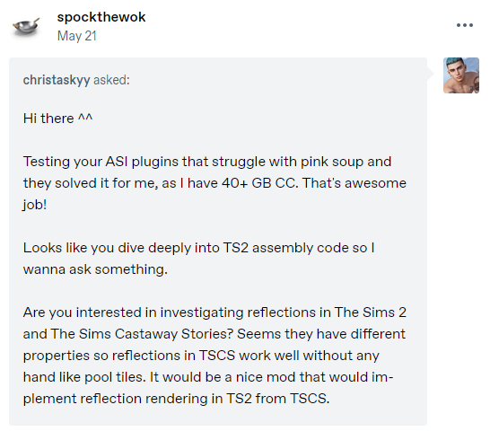
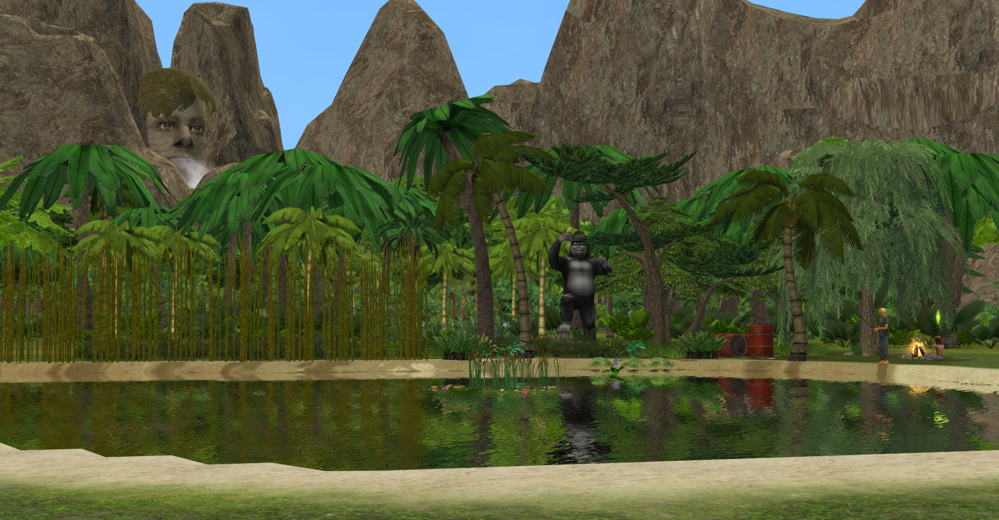
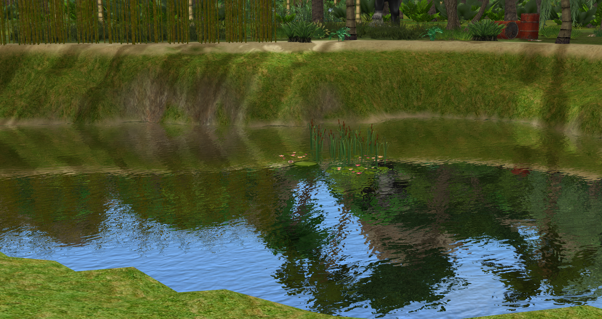
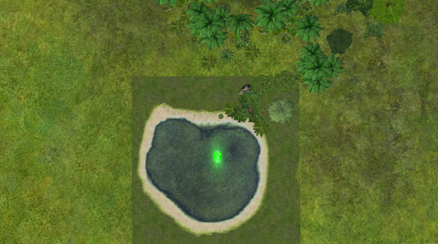
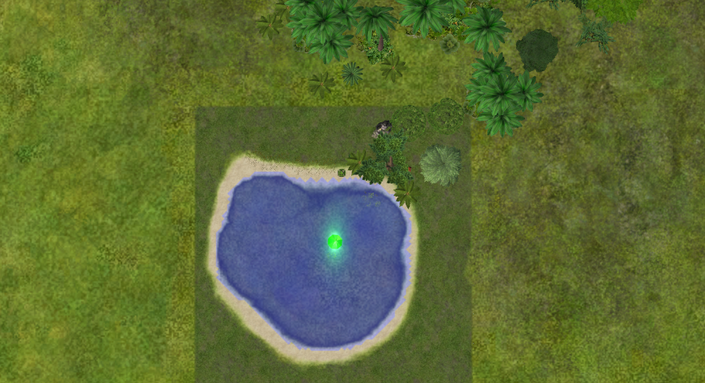

# A Parting Gift
If you've been following me for a while, you might remember that almost exactly 4 months ago, [@christaskyy](https://www.tumblr.com/christaskyy) asked if it would be possible
to backport the water rendering from Castaway Stories, allowing us to have reflective pond water in TS2 without the use of something like a pool tile:

At the time, I was younger and much dumber, so my answer was essentially "no, sorry &mdash; not possible".

*Weeelllllllll...*

Your eyes do not deceive you, ladies and gentlemen. This isn't edited, there's no pool tile hidden off-camera, and there's certainly no AI fuckery going on. It's merely pure,
unadulterated pond reflection goodness, working almost exactly the same as it does in Castaway Stories *(although, if you saw my last post, I suppose it's not really much of
a surprise).*

On top of that, I'm also throwing in updates for two of my other mods. That's right! Three updates for the price of ~~one~~ none!

For once, all of the download links will be ***BELOW*** the cut, because I'm cruel and require you to read things. Sorry :(

*And yes, you still require The Sims 2: Ultimate Collection or the disc version with all EPs and SPs to use these mods. Nothing's changed in that regard.*

Before we get to the pond reflections, let's quickly speed through the mod updates that nobody cares about, starting with the most boring first:

## TS2 Visible Hood FX v1.2.1
- Fixed the game nuking decals if the camera was moved a certain distance away from a lot.

- Updated the shaders to fix z-fighting between shadows and roads.

- Added a [Sky Fix](https://modthesims.info/d/569032/sky-fix.html) compatible version of the shaders.

- In case you find it useful for your blacklists, I also compiled
  [a list of all of the effects in the vanilla game](https://github.com/spockthewok/TS2VisibleHoodFX/blob/main/EFFECTS.md).

[**DOWNLOAD**](https://github.com/spockthewok/TS2VisibleHoodFX/releases/latest)

[**README**](https://github.com/spockthewok/TS2VisibleHoodFX/blob/main/README.md)

*"Wow, that was boring... Really glad you wasted our time with that one..."*

Yeah, yeah &mdash; I know. Anyway, next up is literally no one's favourite mod:

## TS2 Beta Floors v2.0.0
I do have to give a shout-out to this, because even though it's a bit of an ugly duckling of a mod, we wouldn't have pond reflections without it. It's seen a major overhaul,
so while it still has its flaws, it works a hell of a lot better than it used to.

**Shaders:**
- Fixed reflective floors not appearing in imposters.

- Fixed incorrect lightmap scaling for reflective floors, which was causing them to be noticeably darker than non-reflective floors.

- Perhaps most importantly &mdash; **I've fixed mirror and floor reflections fighting each other.** This means mirrors will no longer erratically flicker between what they're
  reflecting, and what floors are reflecting. Yay!

- Toned down the reflectivity of most floors, so they look a bit more natural and aren't so obnoxious.

- Added a slight distortion effect to the reflections, because I didn't like how clean/perfect they looked.

- Added three new reflective floors: *"Narrower Planks" Wooden Flooring, On the Court Wood, On the Court Wood (Raw)*.

- Removed reflections from the following floors: *Stone Cool from Future Waffles* (the reflections didn't really suit them, imo).

**Plugin:**
- Massively simplified and optimised the code.

- Fixed a Maxis bug where floor reflection planes could be placed at the bottom of ponds, which caused all floor reflections to draw much lower than they were supposed to
  (more on this later).

[**DOWNLOAD**](https://github.com/spockthewok/TS2BetaFloors/releases/latest)

[**README**](https://github.com/spockthewok/TS2BetaFloors/blob/main/README.md)

Phew... That wasn't so bad, was it? With that out of the way, now we can get to the good stuff.

## TS2 Reflective Water v2.0.0
Despite this being a rather major update, the changelog is relatively simple:

- Added working pond reflections.

- Added a config file.

That being said, there's some neat little features I'd like to highlight. The one I'm most proud of is that the reflections will react to you using the terrain tools on
ponds. Here we can see the same pond from the first screenshot, except I've lowered the elevation of the terrain:

Notice how the reflection matches the new elevation? Pretty cool, right?

On the shader side of things, have you ever used a reflective pond mod and found that the pond water in lot imposters sort of... disappears? That's because reflective ponds
are only made up of two textures &mdash; a bump map, and the reflection texture, which is invisible. I've fixed this, so the non-reflective version of ponds will be created
for lot imposters.

*Literally any reflective pond mod ever (this even happens in Castaway Stories):*

*My shaders:*

Another fun reflection fact for you &mdash; reflections for any surface break if you view them through a different reflection. For example, if you look at the ocean through a
mirror, the ocean reflections stop working and slide around the surface. Maxis knew this because they prevented mirrors appearing in other reflective surfaces, but they
forgot to do the same in reverse. I have therefore made it so the non-reflective versions of ponds and the ocean will appear in the reflections of other surfaces (this mod
doesn't touch swimming pools, so those will obviously still break unless you fix them yourself).

The shaders also include the mirror fixes from TS2 Beta Floors, so ponds and mirrors can happily coexist without trying to exert dominance over each other's reflections.

And because I know someone is bound to ask &mdash; yes, you can technically use a different pond water shader with this mod (i.e. Voeille's), but you'll need to open it in
SimPE, find the line in the shader that says `"PoolReflection"`, and replace it with `"ScreenReflection"`. Why have I not already done this? Because then I'd have to make
7,000,000 additional compatibility patches, and to be frank &mdash; I really can't be bothered.

I've already included compatibility patches for various other shader mods, and you can find the details on those in the README.

The major caveat with the pond reflection feature is that it is ***incompatible with the plugin from TS2 Beta Floors***. If you wish to use them both together, you
***must*** disable pond reflections in the mod's new config file.

It's still possible to get semi-working pond reflections with TS2BetaFloors by installing the pond water shaders, but the reflections will shift up/down when switching the
game's camera between floors on a lot, the same as floor reflections do.

If you're feeling conflicted about sacrificing floor reflections for pond reflections (or vice versa), then my recommendation would be to choose the pond reflections.
Although floor reflections look nice, the honest truth is that they were cut for a reason &mdash; they're really fucking broken.

I wrote an [entire post](2026-09-15.md) detailing some of the limitations with the game's reflections,
but my main issue with the floors is with how the height of the reflections is calculated. Remember that bug I mentioned I fixed, where floor reflection planes could end up
at the bottom on ponds? That's because the height of the reflections for *all* floors on a lot is calculated using the elevation of only the floor tile at the centre of the
lot.

I presume this is because this is where houses are going to be most commonly built, but if there's a pond in the centre, the elevation of a tile at the bottom of the pond
will be used, so everything breaks.

This system also doesn't account for buildings not built in the centre of a lot, the lot having uneven terrain, the lot having multiple buildings (particularly if some are
built on foundations, and some aren't), basements, and so on. Unless you're always going to build houses exactly how the floor reflections expect you to, they're basically
never going to look right :/

I think that's enough waffling (I'm getting sick of the word "reflection"), so I won't keep you waiting any longer:

[**DOWNLOAD**](https://github.com/spockthewok/TS2ReflectiveWater/releases/latest)

[**README**](https://github.com/spockthewok/TS2ReflectiveWater/blob/main/README.md) *(please)*

## The End(?)
So... We've reached the end. And I don't just mean the end of this post, I mean the end of my short-lived career making mods for The Sims 2.

I've been considering this for a while, but I've kind of reached the point where I've run out of steam and I don't have the same level of enthusiasm that I used to. No one
wants to do something they don't enjoy, and I can feel myself becoming increasingly frustrated, less patient, and less inspired as time goes on. Because of this, I've decided
to call it quits.

Will this be permanent? Who knows? I could come back after a month, or I might never release a new mod ever again. I'll still be playing the game, so I'm sure I'll silently
release another update for something when I spot a bug, and I'll still be on here interacting with posts every once in a while. Either way, I'll be around.

Apologies about all the requests I never got around to finishing. I'm still keeping them in the back of my mind in case I find the motivation to work on them again.

But hey &mdash; we've had some good times, haven't we? We've had some laughs, discovered some cool things, and got to enjoy some pretty okay mods along the way. Not bad for
~6 months work.

[Byeeeeeeeee!](https://www.youtube.com/watch?v=EVw7fzIP6cQ)

Will <3

*Now I've said this, there's going to be a bug in one of these updates that I'm going to have to fix in the next few days, isn't there?*

---

***Originally Posted:*** *22nd September 2026 01:46*

***Tags:*** *sims 2, the sims 2, ts2, sims 2 download, update, reflective water, beta floors, visible hood fx*